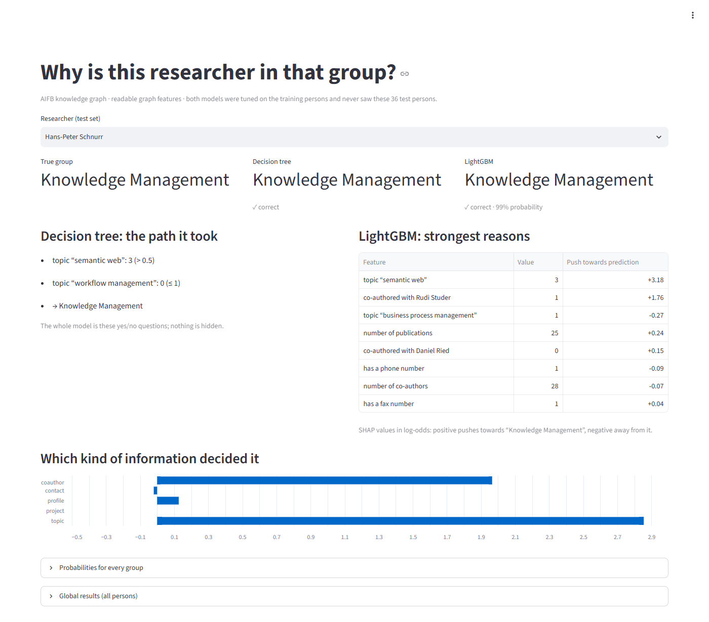
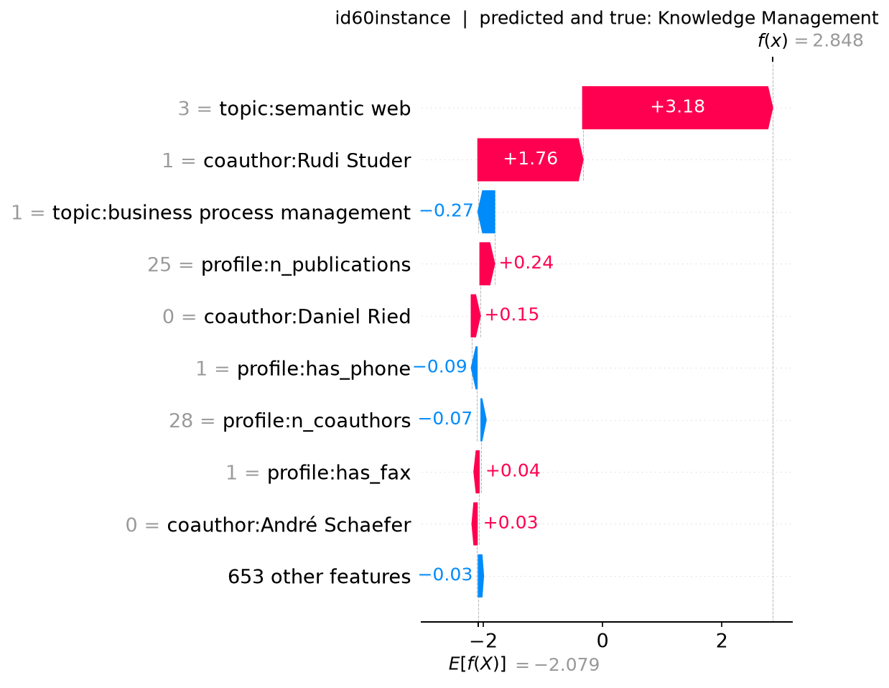
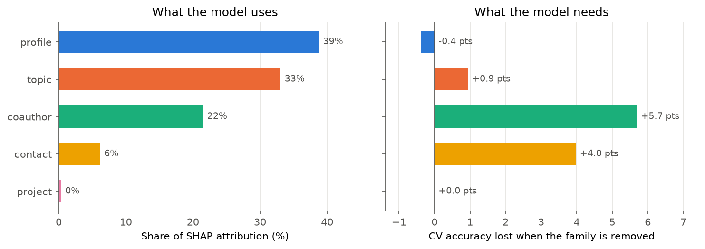
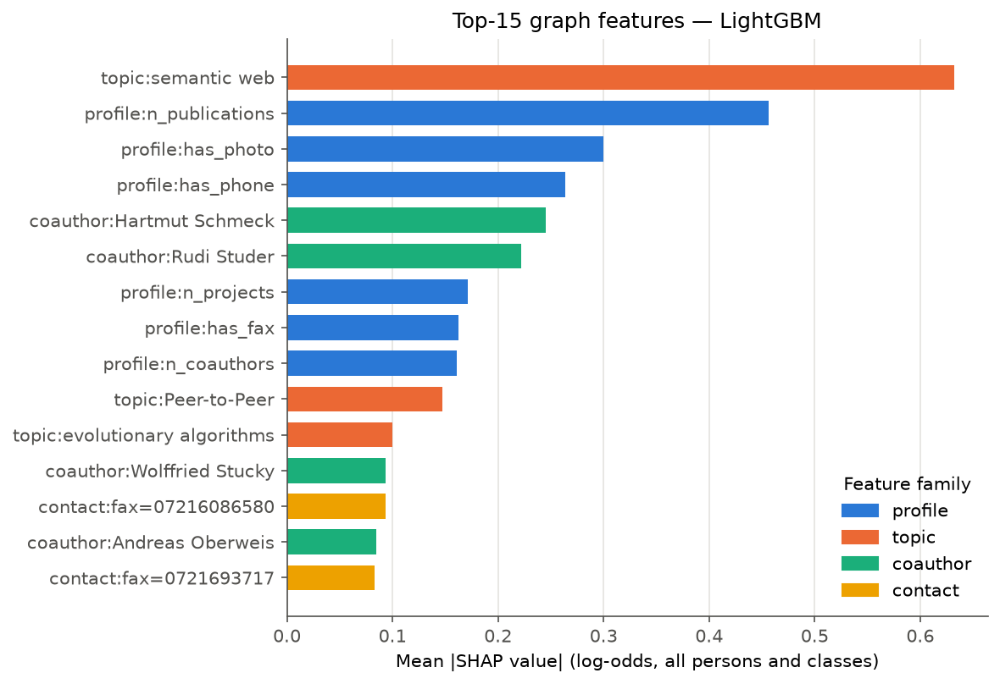
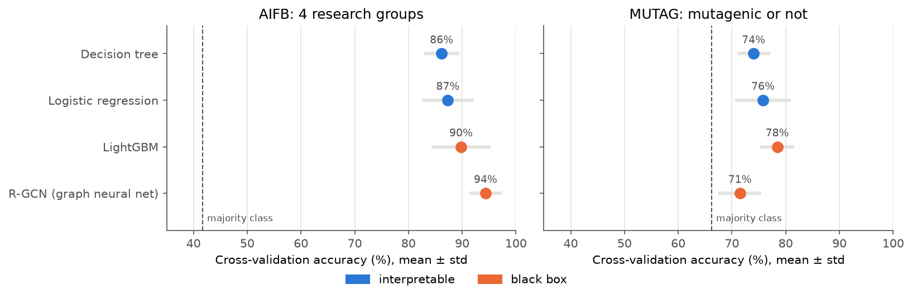
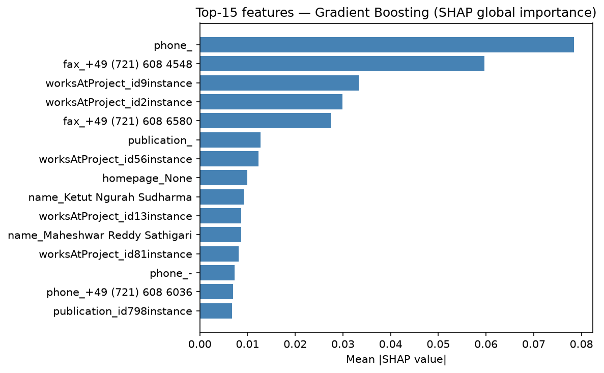

# Explainable Knowledge-Graph Classification

[](https://github.com/abhiwalikar1999/explainable-kg-classification/actions/workflows/ci.yml)

**Predict a researcher's group from the AIFB knowledge graph with readable
graph features, and show that a simple decision tree can match a black box
once the features describe the graph properly.**

The AIFB knowledge graph describes the people, publications, projects and
research topics of the AIFB institute (KIT) in about 29k RDF triples. The
task: given a person, predict which of 4 research groups they belong to, and
explain *why*.

## Highlights

- **Readable graph features.** Every feature is named `family:item`, e.g.
  `topic:semantic web`, `coauthor:Rudi Studer` or `profile:has_phone`, so
  explanations read in the graph's own terms. Values that belong to a single
  person, such as names, are dropped inside every CV fold.
- **The interpretable model catches up.** A depth-5 decision tree reaches
  **86%** in nested cross-validation, up from 63% on the original one-hot
  table. That's 10 points above the original Gradient Boosting black box
  (76%).
- **Leakage audit.** Besides the label relation and its inverse, the graph
  still links research groups to their own members (`member`, `head`). All
  direct person↔group edges are removed, and tests fail if any come back.
- **Honest evaluation.** Hyperparameters are tuned on the training persons
  only, then scored with nested repeated CV, the 36-person test split with
  95% Wilson intervals, and a majority-class baseline.
- **Explanations checked against each other.** TreeSHAP, feature-family
  ablation, a surrogate tree and permutation importance answer different
  questions, and they don't always agree.
- **Compared against a graph neural network and a second dataset.** An
  R-GCN rebuilt to the original paper's settings, plus MUTAG (molecules),
  handled by a schema-agnostic feature builder with one config entry per
  dataset.
- **Reproducible and quality-gated.** One command runs the whole pipeline,
  a Docker image serves an interactive demo, and 45 unit tests plus a
  model-quality gate (run in CI) fail if the published accuracy stops
  reproducing.

## Try it

**[Live demo](https://explainable-kg-classification.purplerock-f0a543f4.francecentral.azurecontainerapps.io)** on Azure Container Apps. It scales to zero when
nobody is using it, so the first visit after a quiet spell takes a few
seconds longer while the container starts.

Or run it locally:

```bash
docker build -t explainable-kg-classification .
docker run --rm -p 8501:8501 explainable-kg-classification
# open http://localhost:8501
```

Pick any of the 36 test researchers (the models never saw them) to see the
true group, both models' predictions, the decision tree's path in plain
sentences, LightGBM's strongest SHAP reasons, and which kind of graph
information decided it.



## Results

Nested cross-validation accuracy (5×3 folds, all 176 labelled persons):

| Features | Logistic Regression | Decision Tree | LightGBM |
|---|---|---|---|
| One-hot table (original pipeline) | 75.0% | 63.4% | 69.7% |
| **Graph features** | 87.3% | **86.2%** | **89.8%** |
| Graph features + group paths | 90.0% | 84.5% | 90.5% |

- LightGBM on graph features scores **91.7%** on the standard 36-person test
  split (95% CI 78–97%). The majority-class baseline is 41.7%.
- *Group paths* count a person's papers and projects that a research group
  publishes or runs. These two-hop paths to the label are proxies, so they
  are kept separate. They add little, because the graph features already
  carry that information.
- Every number, including test accuracy with confidence intervals and the
  chosen hyperparameters, is in `outputs/results/experiments.json`.

### What the decision tree learned

The tuned tree reads as six rules. Topics come from a person's papers,
projects and stated research interests. Two small exceptions covering 3
training persons are omitted; the full tree is in
`outputs/results/tree_rules_graph.txt`.

1. Has the topic **semantic web** → *Knowledge Management*
2. else co-authored with **Hartmut Schmeck** → *Efficient Algorithms*
3. else has the topic **computational finance** → *Complexity Management*
4. else co-authored with **Rudi Studer** → *Knowledge Management*
5. else has the topic **evolutionary algorithms** → *Efficient Algorithms*
6. otherwise → *Business Information and Communication Systems*



## What the explanations show



- **What the model *uses* is not what it *needs*.** SHAP gives the
  `profile` family (publication counts, which contact fields are filled in)
  the largest share of attribution, 39%. Yet removing that family costs no
  accuracy at all: topics and co-authors carry the same information.
  Co-authors alone reach 85% and topics alone 84%.
- **One shortcut remains.** For *Complexity Management*, the smallest group,
  `has_photo` and `has_fax` are among the strongest drivers. That reflects
  how complete people's profiles are, not their research.
- **Co-authoring with a group's head** (Rudi Studer, Hartmut Schmeck) is a
  strong signal. It's legitimate relational evidence, but close to the
  label.
- **A depth-5 surrogate tree** reproduces LightGBM's prediction for 83% of
  test persons.
- **Explanation methods agree more on meaningful features.** The top-20
  overlap between SHAP and permutation importance doubles from 0.33 (one-hot
  table) to 0.67 (graph features), though they still rank those features
  differently (Spearman 0.42).



## Beyond AIFB: a graph neural network and a second dataset



- **Graph neural network.** A featureless R-GCN with the original paper's
  settings, trained on the same graphs; the node and edge counts match the
  paper's exactly. On AIFB it reaches **94%** in cross-validation (96% on
  the test split, mean of 10 seeds). That's 4 points above LightGBM and 8
  above the decision tree, so on AIFB readability costs about 8 points
  against a GNN.
- **The extra leaky edges don't explain the GNN's score.** Its CV accuracy
  is 95.5% on the graph used in the literature, 94.3% without the groups'
  `member` / `head` edges, and 93.8% with every edge touching a research
  group removed.
- **MUTAG** (340 molecules, mutagenic or not; 66% majority class), with
  generic features that know nothing about chemistry: LightGBM 78%,
  logistic regression 76% and the decision tree 74% all beat the R-GCN
  (71%; paper: 73%). The tree splits on chemistry: aromatic carbon atoms
  and ring structures.
- **Generic features on AIFB** reach 90.5% with LightGBM, as good as the
  handcrafted features, but they read as ids instead of names.

GNN numbers are in `outputs/results/gnn_aifb.json` and `gnn_mutag.json`;
the generic-feature results are in `benchmarks.json`.

## Before: the original one-hot pipeline

The starting point turned every RDF subject into a row and every predicate
into a column, one-hot encoded. Gradient Boosting reached 86.1% on the test
split but only 75.9% ± 5.5% in repeated CV. Its top features were `phone_`,
which means the phone field is **empty**, and the names of individual
persons: the model was memorising identities.



## How it works

```
AIFB RDF graph (N3, ~29k triples)
  → remove label leakage (affiliation, employs, group member/head)   src/dataset.py
  → graph features per person: profile, contact, project,
    topic, coauthor (+ optional group paths)                         src/features.py
  → Logistic Regression / Decision Tree / LightGBM,
    tuned on train, nested repeated CV                               src/experiments.py
  → TreeSHAP, family ablation, surrogate, importance agreement       src/explain_graph.py
  → figures                                                          src/figures.py

Other benchmarks (config per dataset, generic 1- and 2-hop features):
  src/benchmarks.py, src/generic_features.py
R-GCN baseline (PyTorch Geometric):        src/gnn.py
Original one-hot pipeline: src/train.py, src/explain.py, src/evaluate.py
One command for every stage:               src/pipeline.py (Makefile wraps it)
One person, in plain language:             src/predict.py
  → every test person precomputed            outputs/results/demo_explanations.json
  → demo (reads only that file)              app/demo.py
```

## Engineering

- **CI (GitHub Actions):** lint → unit tests → model-quality gate → Docker
  build → tests inside the image (including a headless run of the demo) →
  demo health check; in parallel, the small demo image is built,
  health-checked and published to GitHub Container Registry.
- **Model-quality gate** (`tests/test_quality_gate.py`): retrains the
  graph-feature models and fails if their test accuracy differs from
  `experiments.json` by more than one test person, or drops below the
  agreed floors (80% decision tree and logistic regression, 85% LightGBM,
  80% in 5-fold nested CV).
- **Demo:** the pipeline precomputes every test person's explanation
  (`demo_explanations.json`, checked against freshly fitted models by a
  test), so the demo needs only streamlit and pandas. Its image
  (`app/Dockerfile`) is served by Azure Container Apps with 0.5 vCPU and
  scale to zero (at most one replica). Fitting the models at startup
  instead would take about 3 min on a small CPU share.
- **Leakage tests:** fail if any edge links a person directly to a research
  group, or if a feature family other than group paths reaches a group
  node.
- Fixed seeds, pinned dependencies, results written as JSON, optional
  dependencies split out (`requirements-demo.txt`, `requirements-gnn.txt`).

## Quickstart

With Docker (no local Python needed):

```bash
docker build -t explainable-kg-classification .
docker run --rm -p 8501:8501 explainable-kg-classification            # demo
docker run --rm explainable-kg-classification python -m src.pipeline  # rerun everything
```

Locally:

```bash
python -m venv .venv && source .venv/bin/activate   # Windows: .venv\Scripts\activate
pip install -r requirements-demo.txt

python -m src.pipeline        # every stage in order (~8 min) -> outputs/results/, outputs/figures/
streamlit run app/demo.py     # the demo
pytest -q -m "not quality"    # unit tests, incl. leakage tests
pytest -q -m quality          # model-quality gate
ruff check src tests app

pip install -r requirements-gnn.txt            # optional: PyTorch + PyTorch Geometric
python -m src.pipeline --stages gnn figures    # R-GCN baselines (~45 min, CPU)
```

`python -m src.pipeline --stages <name>` runs single stages: experiments,
explain_graph, demo, benchmarks, train, evaluate, gnn, figures. On Linux and
macOS, `make test`, `make quality`, `make pipeline` and `make demo` are
shortcuts.

## Data

`data/aifb-hetero/` contains the AIFB dataset (Bloehdorn & Sure, *Kernel
Methods for Mining Instance Data in Ontologies*, ISWC 2007) with the
train/test split distributed on
[figshare](https://figshare.com/articles/dataset/AIFB_DataSet/745364/1).

MUTAG is downloaded on first use from the R-GCN benchmark copy
(`data.dgl.ai`) into `data/downloads/`, which is not committed.
